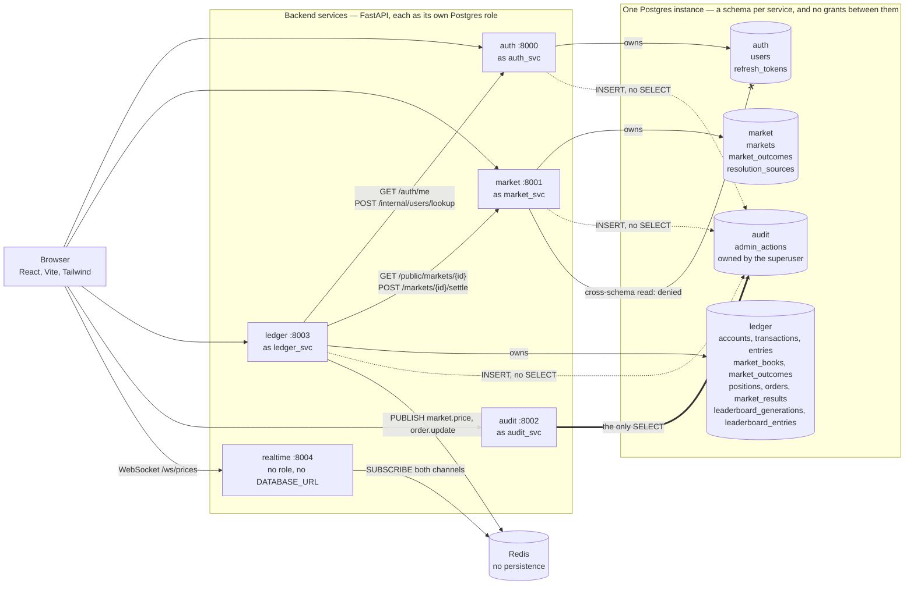
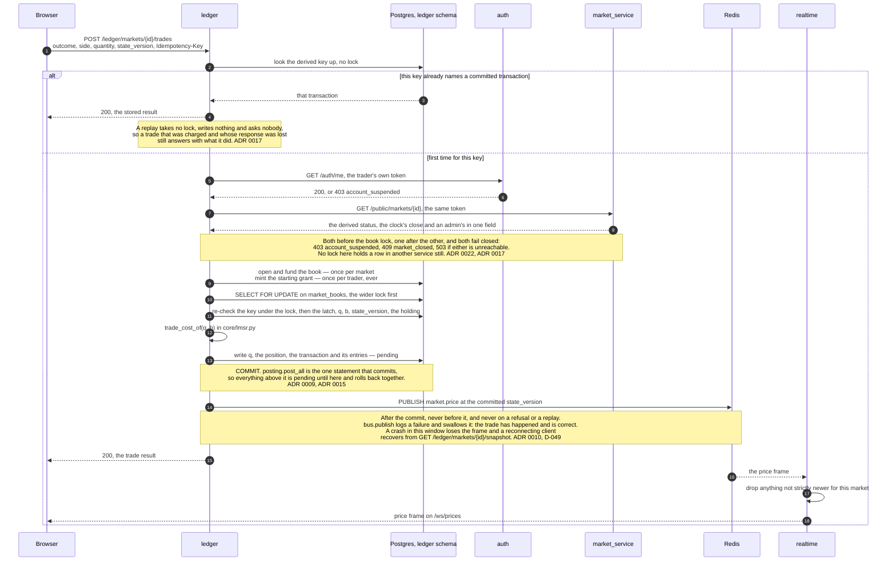
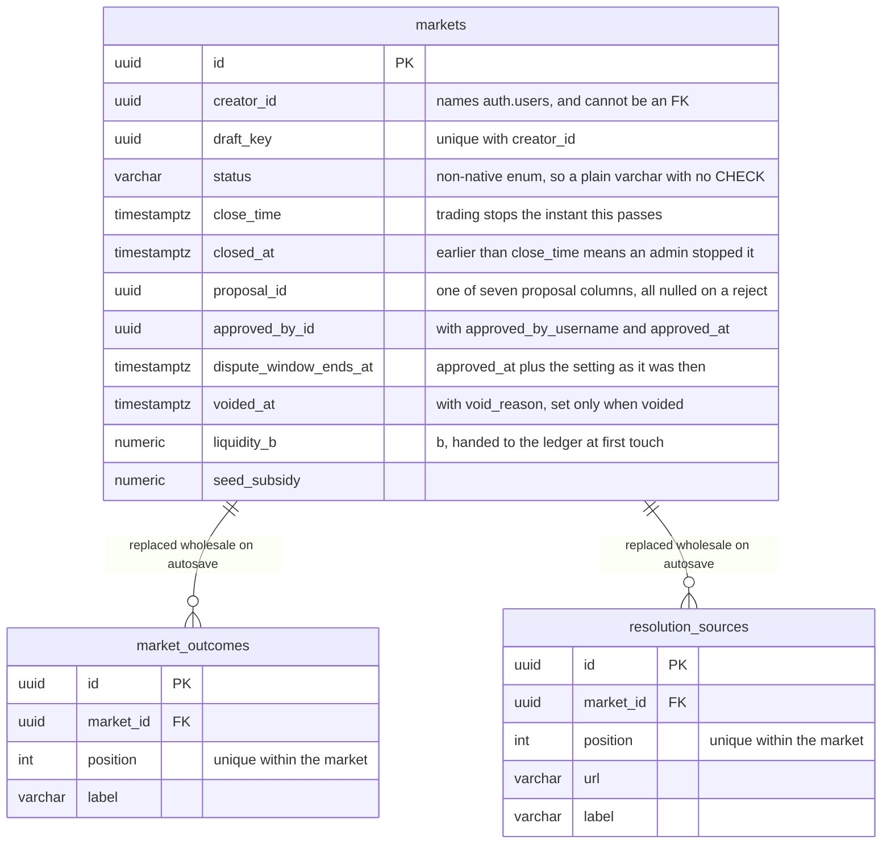
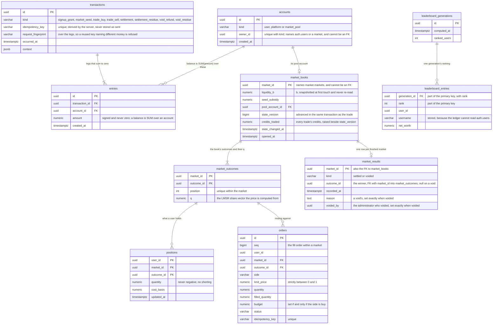

# Architecture

Three diagrams — what the services are and what each one owns, what a trade
does, and what the tables look like, the last split into one ERD per schema.
They are a map of decisions written down elsewhere, not a second copy of them:
each names the ADR or `DECISIONS.md` entry it was drawn from, and where a
diagram and its source disagree, the source is right and the diagram is the
bug.

## The services and what they own

**Drawn from:** [ADR 0003](adr/0003-market-service-boundary.md) (the boundary
and the token), [ADR 0006](adr/0006-audit-log-write-path.md) (the audit grants),
[ADR 0010](adr/0010-realtime-price-broadcast.md) (a relay that owns nothing,
and Redis rather than the database),
[ADR 0017](adr/0017-the-ledger-and-a-stopped-market.md) and
[ADR 0022](adr/0022-the-ledger-and-a-suspended-trader.md) (the ledger's two
per-trade hops), [ADR 0019](adr/0019-settlement-across-services.md) (settlement
tells market_service afterwards),
[ADR 0021](adr/0021-the-leaderboard-and-the-first-service-credential.md) (the
leaderboard's service key), and `sql/01-roles.sql` with `sql/02-schemas.sql`
for the roles and grants themselves.

The arrows into Postgres are the whole of each role's access. The crossed one
stands for every pair not drawn: `market_svc` cannot read `auth`, `ledger_svc`
cannot read `market`, and so on, which is why `market.markets.creator_id` and
`ledger.accounts.owner_id` name rows they cannot reference. The arrow from
`realtime` to Redis points at what it subscribes to; the frames travel the
other way. What the drawing cannot say for itself:

- **`realtime` has no database at all** — no role in `sql/01-roles.sql`, no
  schema, no `DATABASE_URL`, and SQLAlchemy is absent from its
  `requirements.txt`. It is the only service a change under `sql/` cannot
  break, and ADR 0010 argues that is most of what made a fifth service
  affordable.
- **The audit log is written by the acting service**, on the request's own
  session and in the request's own transaction. There is no write endpoint on
  `:8002` and the dashed arrows are not calls to it (ADR 0006). `audit_svc`
  also holds INSERT, so its own suite can seed rows; nobody anywhere holds
  UPDATE, DELETE or TRUNCATE.
- **The three arrows out of the ledger carry two different credentials.**
  `/auth/me`, `/public/markets/{id}` and `/markets/{id}/settle` forward the
  caller's own access token unchanged; `/internal/users/lookup` presents
  `LEDGER_SERVICE_KEY`, which is the only service credential in the system and
  has one caller and one route (ADR 0021).
- **Nothing depends on `audit` or `realtime`**, and compose says so: neither is
  in any other service's `depends_on`. A trade survives both being down.
- Every image is built from `backend/` so it carries `backend/shared/` beside
  the service ([ADR 0012](adr/0012-the-shared-package.md)).

## A trade, end to end

The one path that crosses three services. The two upstream checks happen before
any lock is taken, and the price frame happens after the commit.

**Drawn from:** [ADR 0017](adr/0017-the-ledger-and-a-stopped-market.md) (the
replay-before-gate and gate-before-lock order),
[ADR 0022](adr/0022-the-ledger-and-a-suspended-trader.md) (the account check,
and its place in that order),
[ADR 0015](adr/0015-locking-the-read-that-decides-a-write.md) (the book lock
first, the key re-checked under it),
[ADR 0009](adr/0009-the-ledger-write-path.md) (one commit, legs that sum to
zero), [ADR 0010](adr/0010-realtime-price-broadcast.md) (publish after the
commit, and the version gate), and `DECISIONS.md` D-049 (a publish failure is
swallowed and logged) and "One price frame per commit, at the final
`state_version`". The code is
`ledger_service/service/trading.py::execute`.

Two things left off to keep it one path. A commit that moved the price may also
fill resting limit orders inside the same transaction, which adds `order.update`
frames after the price frame
([ADR 0024](adr/0024-resting-orders-fill-inside-the-trade.md)). And the preview
deliberately does not make either upstream call, because it decides nothing —
so a preview can quote a market whose trade then returns `409 market_closed`
(ADR 0017).

## The schemas

Each service builds its schema from its own Alembic history, run as a one-off
step before the app starts ([ADR 0020](adr/0020-migrations-by-alembic.md)).
`audit.admin_actions` is the exception: `sql/02-schemas.sql` creates it, because
no writer holds CREATE there.

Each entity below shows the columns that carry a decision, not every column.
`backend/<service>/model/entities.py` is the complete list, and it is where the
constraints and the reasoning live.

### `market`

**Drawn from:** [ADR 0011](adr/0011-market-auto-close.md) (`close_time` is the
authority and `status` is written down afterwards),
[ADR 0014](adr/0014-closing-a-market-early.md) (`closed_at` earlier than
`close_time` is how an early close is told apart),
[ADR 0013](adr/0013-proposing-an-outcome.md) and
[ADR 0016](adr/0016-deciding-a-proposal.md) (the proposal columns, and
`proposal_id` on a decision),
[ADR 0023](adr/0023-sending-an-approved-outcome-back.md)
(`dispute_window_ends_at` stored at approval),
[ADR 0025](adr/0025-voiding-a-flawed-market.md) (`void_reason` kept on the
row for traders, and no `voided_by`), and
[ADR 0003](adr/0003-market-service-boundary.md) (`creator_id` is not a foreign
key).

Zero-or-more on both, not two-or-more: a draft may have no outcomes yet, and
the minimum is a submission rule rather than a constraint. Replacing either
collection needs its own flush, or the new rows and the orphans collide on the
position constraint within one flush — `_clear_children` is there for that.

### `ledger`

**Drawn from:** [ADR 0009](adr/0009-the-ledger-write-path.md) (no balance
column, signed entries summing to zero, the lazily minted grant),
[ADR 0005](adr/0005-trading-service-boundary.md) and
[ADR 0017](adr/0017-the-ledger-and-a-stopped-market.md) (`market_books` holds
snapshotted terms and carries no status or closing time),
[ADR 0018](adr/0018-positions-are-valued-at-liquidation.md) (what a position is
worth), [ADR 0019](adr/0019-settlement-across-services.md) (`market_results`,
one row per finished market),
[ADR 0021](adr/0021-the-leaderboard-and-the-first-service-credential.md) (the
leaderboard is a snapshot, with the username stored on it),
[ADR 0024](adr/0024-resting-orders-fill-inside-the-trade.md) (`orders`), and
[ADR 0025](adr/0025-voiding-a-flawed-market.md) (a void's `market_results` row,
with its `reason` and `voided_by`, and the `void_refund` and `void_residue`
kinds).

Two absences are the point of this one.

**`accounts` has no balance column and must not grow one.** A balance is
`SUM(amount)` over that account's entries, derived on every read, which is what
makes three separate acceptance criteria true by construction instead of by
vigilance. The table exists to give an account an identity a foreign key can
point at and a single row the write path can lock. Credits are minted by the
one `PLATFORM` account going negative, so `SUM(amount)` over the whole of
`entries` is always exactly zero.

**`entries` has no UPDATE or DELETE path, and a trigger says so at the
database.** `model/entities.py` attaches it as an `after_create` event, so the
per-test schema rebuild gets it, and the Alembic baseline runs the same SQL for
real databases — editing one without the other changes only fresh databases.
`market_results` deliberately carries no such trigger, and `positions` cannot:
it is a rollup, updated on every later trade in the same market.

The other two schemas are small enough to read directly. `auth` is `users` and
`refresh_tokens` (`backend/auth_service/model/entities.py`); `audit` is the
single `admin_actions` table defined in `sql/02-schemas.sql`, whose columns and
grants that file explains at length. No relationship in any of the four crosses
a schema boundary, and the ids that look like they should —
`market.markets.creator_id`, `ledger.accounts.owner_id`,
`ledger.market_books.market_id` — are the cost ADR 0003 chose to pay.
