# Architecture

Three diagrams — what the services are and what each one owns, what a trade
does, and what the tables look like, the last split into one ERD per schema.
They are a map of decisions written down elsewhere, not a second copy of them:
each names the ADR or `DECISIONS.md` entry it was drawn from, and where a
diagram and its source disagree, the source is right and the diagram is the
bug.

[The diagram set](#the-diagram-set), at the end, is a second set drawn for the
final proposal: shorter labels that print at half or full A4 width, and the
parts these three do not draw — the production deployment, CI/CD, security,
the market lifecycle, settlement, scaling, the live-price fan-out and a
delivery timeline.

## The services and what they own

**Drawn from:** [ADR 0003](adr/0003-market-service-boundary.md) (the boundary
and the token), [ADR 0006](adr/0006-audit-log-write-path.md) (the audit grants),
[ADR 0010](adr/0010-realtime-price-broadcast.md) (a relay that owns nothing,
and Redis rather than the database),
[ADR 0017](adr/0017-the-ledger-and-a-stopped-market.md) and
[ADR 0022](adr/0022-the-ledger-and-a-suspended-trader.md) (the ledger's two
per-trade hops), [ADR 0019](adr/0019-settlement-across-services.md) (settlement
tells market_service afterwards),
[ADR 0021](adr/0021-the-leaderboard-and-the-first-service-credential.md) (the
leaderboard's service key), and `sql/01-roles.sql` with `sql/02-schemas.sql`
for the roles and grants themselves.

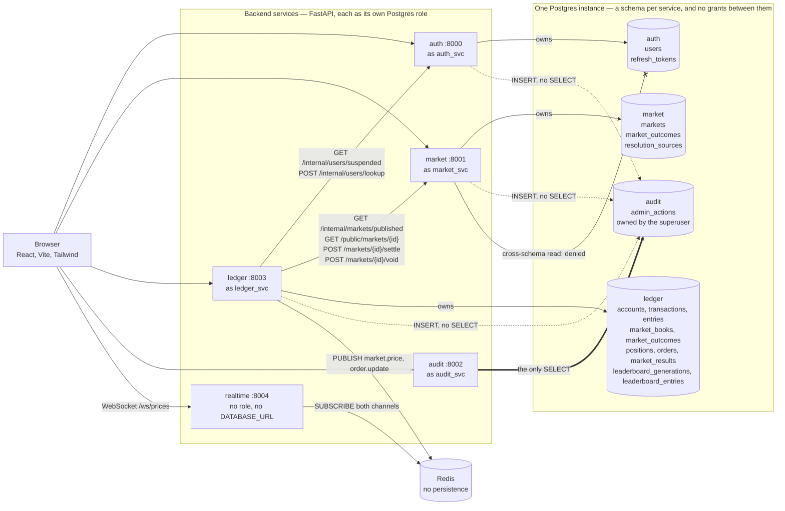

The arrows into Postgres are the whole of each role's access. The crossed one
stands for every pair not drawn: `market_svc` cannot read `auth`, `ledger_svc`
cannot read `market`, and so on, which is why `market.markets.creator_id` and
`ledger.accounts.owner_id` name rows they cannot reference. The arrow from
`realtime` to Redis points at what it subscribes to; the frames travel the
other way. What the drawing cannot say for itself:

- **`realtime` has no database at all** — no role in `sql/01-roles.sql`, no
  schema, no `DATABASE_URL`, and SQLAlchemy is absent from its
  `requirements.txt`. It is the only service a change under `sql/` cannot
  break, and ADR 0010 argues that is most of what made a fifth service
  affordable.
- **The audit log is written by the acting service**, on the request's own
  session and in the request's own transaction. There is no write endpoint on
  `:8002` and the dashed arrows are not calls to it (ADR 0006). `audit_svc`
  also holds INSERT, so its own suite can seed rows; nobody anywhere holds
  UPDATE, DELETE or TRUNCATE.
- **The two arrows from the ledger to auth and market carry six routes and
  two different credentials.** `/public/markets/{id}`,
  `/markets/{id}/settle` and `/markets/{id}/void` forward the caller's own
  access token unchanged;
  the three `/internal/` routes present
  `LEDGER_SERVICE_KEY`, which is the only service credential in the system and
  has one caller and three routes (ADR 0021, ADR 0030).
- **Nothing depends on `audit` or `realtime`**, and compose says so: neither is
  in any other service's `depends_on`. A trade survives both being down.
- Every image is built from `backend/` so it carries `backend/shared/` beside
  the service ([ADR 0012](adr/0012-the-shared-package.md)).

## A trade, end to end

The trade itself calls no other service, except to fetch the terms of a market
the ledger has never touched: the account check and the market gate
read the ledger's local copy, which two background refreshers keep within about
a second of auth and market_service. Both checks happen before any lock is
taken, a close on `close_time` is checked again under it, and the price frame
happens after the commit.

**Drawn from:** [ADR 0017](adr/0017-the-ledger-and-a-stopped-market.md) (the
replay-before-gate and gate-before-lock order),
[ADR 0022](adr/0022-the-ledger-and-a-suspended-trader.md) (the account check,
and its place in that order),
[ADR 0030](adr/0030-the-ledger-keeps-a-local-copy.md) (both checks read a local
copy, and a stale copy refuses),
[ADR 0015](adr/0015-locking-the-read-that-decides-a-write.md) (the book lock
first, the key re-checked under it),
[ADR 0009](adr/0009-the-ledger-write-path.md) (one commit, legs that sum to
zero), [ADR 0010](adr/0010-realtime-price-broadcast.md) (publish after the
commit, and the version gate), and `DECISIONS.md` D-049 (a publish failure is
swallowed and logged) and "One price frame per commit, at the final
`state_version`". The code is
`ledger_service/service/trading.py::execute`.

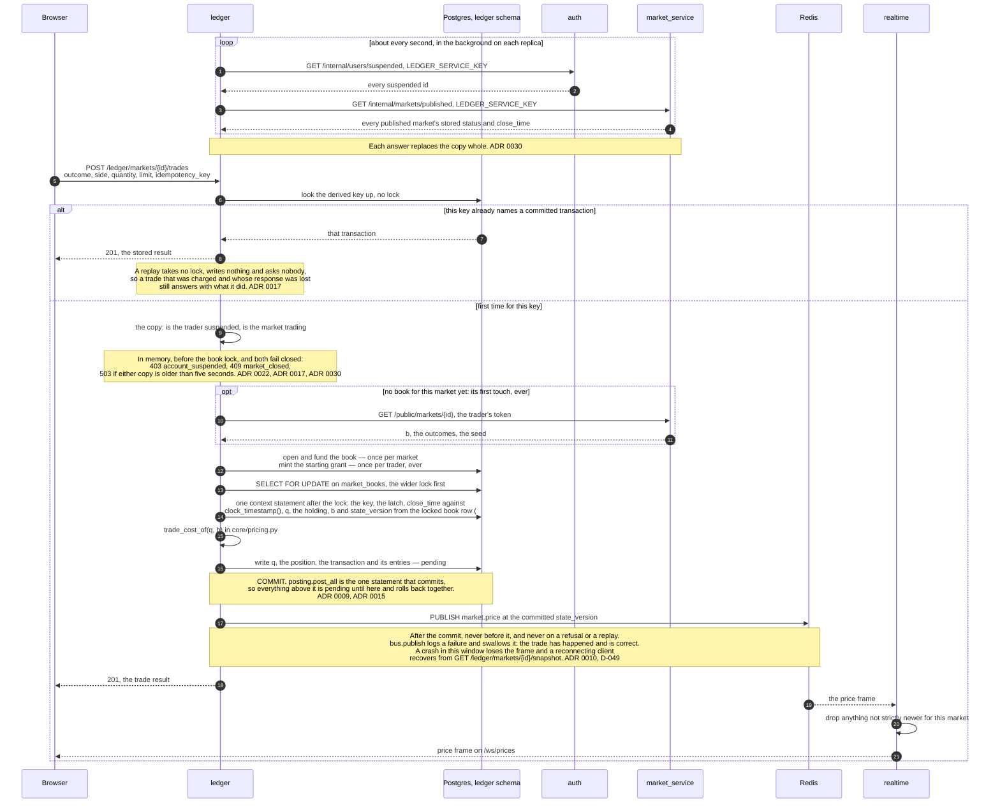

Two things left off to keep it one path. A commit that moved the price may also
fill resting limit orders inside the same transaction, which adds `order.update`
frames after the price frame
([ADR 0024](adr/0024-resting-orders-fill-inside-the-trade.md)). And the preview
deliberately does not consult the copy, because it decides nothing —
so a preview can quote a market whose trade then returns `409 market_closed`
(ADR 0017).

## The schemas

Each service builds its schema from its own Alembic history, run as a one-off
step before the app starts ([ADR 0020](adr/0020-migrations-by-alembic.md)).
`audit.admin_actions` is the exception: `sql/02-schemas.sql` creates it, because
no writer holds CREATE there.

Each entity below shows the columns that carry a decision, not every column.
`backend/<service>/model/entities.py` is the complete list, and it is where the
constraints and the reasoning live.

### `market`

**Drawn from:** [ADR 0011](adr/0011-market-auto-close.md) (`close_time` is the
authority and `status` is written down afterwards),
[ADR 0014](adr/0014-closing-a-market-early.md) (`closed_at` earlier than
`close_time` is how an early close is told apart),
[ADR 0013](adr/0013-proposing-an-outcome.md) and
[ADR 0016](adr/0016-deciding-a-proposal.md) (the proposal columns, and
`proposal_id` on a decision),
[ADR 0023](adr/0023-sending-an-approved-outcome-back.md)
(`dispute_window_ends_at` stored at approval),
[ADR 0025](adr/0025-voiding-a-flawed-market.md) (`void_reason` kept on the
row for traders, and no `voided_by`), and
[ADR 0003](adr/0003-market-service-boundary.md) (`creator_id` is not a foreign
key).

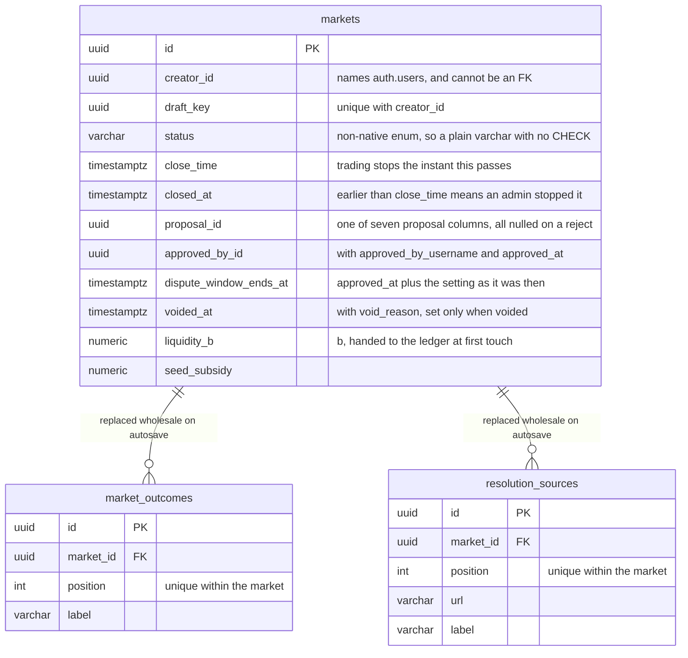

Zero-or-more on both, not two-or-more: a draft may have no outcomes yet, and
the minimum is a submission rule rather than a constraint. Replacing either
collection needs its own flush, or the new rows and the orphans collide on the
position constraint within one flush — `_clear_children` is there for that.

### `ledger`

**Drawn from:** [ADR 0009](adr/0009-the-ledger-write-path.md) (no balance
column, signed entries summing to zero, the lazily minted grant),
[ADR 0005](adr/0005-trading-service-boundary.md) and
[ADR 0017](adr/0017-the-ledger-and-a-stopped-market.md) (`market_books` holds
snapshotted terms and carries no status or closing time),
[ADR 0018](adr/0018-positions-are-valued-at-liquidation.md) (what a position is
worth), [ADR 0019](adr/0019-settlement-across-services.md) (`market_results`,
one row per finished market),
[ADR 0021](adr/0021-the-leaderboard-and-the-first-service-credential.md) (the
leaderboard is a snapshot, with the username stored on it),
[ADR 0024](adr/0024-resting-orders-fill-inside-the-trade.md) (`orders`), and
[ADR 0025](adr/0025-voiding-a-flawed-market.md) (a void's `market_results` row,
with its `reason` and `voided_by`, and the `void_refund` and `void_residue`
kinds).

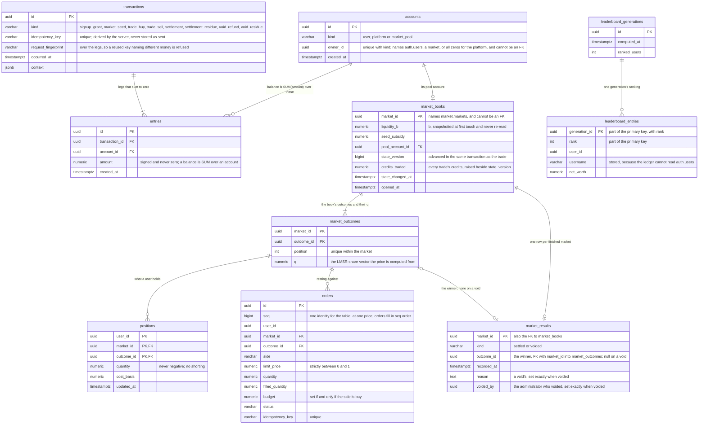

Three ends are kept by the code, not by a constraint: a transaction always has
entries, a book always has outcomes, and a pool account belongs to one book
(D-028). `pool_account_id` has no unique constraint.

Two absences are the point of this one.

**`accounts` has no balance column and must not grow one.** A balance is
`SUM(amount)` over that account's entries, derived on every read, which is what
makes three separate acceptance criteria true by construction instead of by
vigilance. The table exists to give an account an identity a foreign key can
point at and a single row the write path can lock. Credits are minted by the
one `PLATFORM` account going negative, so `SUM(amount)` over the whole of
`entries` is always exactly zero.

**`entries` has no UPDATE or DELETE path, and a trigger says so at the
database.** `model/entities.py` attaches it as an `after_create` event, so the
per-test schema rebuild gets it, and the Alembic baseline runs the same SQL for
real databases — editing one without the other changes only fresh databases.
`market_results` deliberately carries no such trigger, and `positions` cannot:
it is a rollup, updated on every later trade in the same market.

The other two schemas are small enough to read directly. `auth` is `users` and
`refresh_tokens` (`backend/auth_service/model/entities.py`); `audit` is the
single `admin_actions` table defined in `sql/02-schemas.sql`, whose columns and
grants that file explains at length. No relationship in any of the four crosses
a schema boundary, and the ids that look like they should —
`market.markets.creator_id`, `ledger.accounts.owner_id`,
`ledger.market_books.market_id` — are the cost ADR 0003 chose to pay.

## The diagram set

Fifteen figures for the final proposal. Each `.mmd` in
[`diagrams/`](diagrams/) is the source of truth and starts with the files and
ADRs it was drawn from; the images below are its renders, made with
`python docs/diagrams/render.py` (white background, 1600 px wide, one colour
per service). Figure 15 is drawn by its own script, `diagrams/15-lmsr.py`.
[`diagrams/_conventions.md`](diagrams/_conventions.md) has the rules: solid
for what exists, dashed and labelled "not built" for what does not.
The three diagrams above stay the detailed reference; where these and the code
disagree, the code is right.

### 1. System architecture


In production the browser reaches the load balancer, then the gateway on an app
server, which serves the frontend and sends each subdomain to its service. Each
service but realtime connects as its own Postgres role, and the ledger
publishes prices to Valkey after every commit. A trade normally calls no
other service: the ledger keeps a local copy of who is suspended and which
markets are published, refreshed about every second from auth and market with
`LEDGER_SERVICE_KEY` (ADR 0030), and refetches the published list itself only
for a market the copy does not hold yet. The ledger still calls market on a
book's first touch and to read and mark a settlement or a void. The close sweeper,
the leaderboard refresher and the copy's refresh run inside their services. Locally
compose publishes one port per service, no gateway runs, and the bus is Redis.
`audit_svc` holds INSERT as well as SELECT only so that its own suite can seed
rows; the audit service has no write route.
**Drawn from:** ADR 0003, 0006, 0010, 0011, 0017 and 0022 (as amended by
0030), 0019, 0021, 0025, 0026, 0030; `deploy/production/`,
`infra/terraform/load_balancer.tf`, `docker-compose.yml`, `sql/`,
`backend/ledger_service/service/local_copy.py`.
[Source](diagrams/01-system-architecture.mmd)

### 2. Production deployment


Production as built, at <https://predictsmu.xyz>, in DigitalOcean's `sgp1`. The
load balancer ends TLS with a Let's Encrypt certificate and sends HTTP to port 80
of each server whose `/lb-health` answers 200, which is the ledger's `/health`
through the gateway. The firewall admits port 80 from the load balancer only, and
port 22 from anywhere with keys only, because GitHub's runners have no fixed
address. Each gateway serves the frontend and routes `auth.`, `market.`,
`ledger.`, `audit.` and `realtime.` to the containers on its own server. Managed
Postgres and Valkey accept only servers tagged `cs464-app`, over the private
network. The apps reach Postgres through four PgBouncer pools, which hold 38 of
its 47 or so connections however many servers run; auth keeps its login and
registration limits in the same Valkey that carries prices (ADR 0027). Grafana
Alloy on each server sends metrics, logs and traces to Grafana Cloud, which
holds the dashboard and five alerts (ADR 0028). Terraform generates the application's secrets and reads the two that
DigitalOcean makes, the `doadmin` password and the Valkey URL.
`infra/push-secrets.sh` copies them to the GitHub `production` environment, and
`release.sh` writes `app.env` on each server, role passwords included, inside each
role's URL. Only the admin URL stays out of it, reaching a server on stdin. The
dashed box is the Postgres standby ADR 0026 does not buy.
**Drawn from:** ADR 0026, 0002, 0010, 0011, 0020, 0021, 0027, 0028;
`infra/terraform/`, `infra/push-secrets.sh`, `deploy/production/`,
`.github/workflows/deploy.yml`, [deployment.md](deployment.md).
[Source](diagrams/02-cloud-deployment.mmd)

### 3. CI/CD


CI runs path-filtered workflows on every pull request and on pushes to `dev`,
`staging` and `main`. A push to `main`, or a run started by hand on `main`, starts
the deploy: six images go to GHCR, then `release.sh` copies the release directory
to each server, ensures the roles and grants and runs each migration once from the
first server, rolls the servers one at a time, and checks every public name. The
deploy runs no suite and does not wait for CI. `main` is normally reached by
promoting `dev`, but CI is advisory and nothing requires it green. A failed migration
stops the deploy before any server rolls. A failed pull, or a service that does not
start or answer `/health`, sends the servers back to the old release, unless a server
cannot go back, in which case it stays drained and the others stay as they are. No
`/health` reads a database or calls another service, so a release that starts
but cannot serve is not caught. A failed public check rolls nothing back.
**Drawn from:** `.github/workflows/*`, `deploy/production/{release,migrate,roll}.sh`,
ADR 0020, 0026, [deployment.md](deployment.md).
[Source](diagrams/03-cicd.mmd)

### 4. Entity-relationship overview


Key columns of all sixteen tables across the four schemas. Solid lines are
foreign keys, all within one schema; dotted lines labelled "no FK" and columns
marked "→ auth.users" are ids that name a row in another table without a
foreign key: across schemas because no service holds a grant on another's,
and for `proposed_outcome_id` by choice. On solid lines the crow's-foot ends
show what the constraints enforce, on dotted lines what the writing code
does; Mermaid's identifying/non-identifying distinction is not used. In
print it needs a landscape page: its text is about 5.2 pt at the portrait text
width and 7.3 pt at 22.3 cm wide, where it still fits the page's height.
**Drawn from:** `backend/*/model/entities.py`, each service's
`migrations/versions/`, `sql/02-schemas.sql`, ADR 0003.
[Source](diagrams/04-erd-overview.mmd)

### 5. Security


Browsers hold a 15-minute JWT and a single-use, rotating refresh token in
httpOnly cookies; every service verifies the token itself; the ledger checks
a trader against its local copy of suspended accounts and forwards no trader's
token to auth, and the one service key refreshes that copy, the copy of
published markets and the leaderboard's names, on `/internal/` routes that auth
and market check and the gateway hides from the internet; Postgres grants
confine each service to its own schema plus INSERT-only access to the
append-only audit log.
**Drawn from:** ADR 0001, 0002, 0006, 0007, 0021, 0022 (as amended by 0030),
0030; `sql/`, `backend/shared/security.py`, `backend/auth_service/`,
`backend/ledger_service/service/local_copy.py`,
`deploy/production/gateway/private-paths.inc`.
[Source](diagrams/05-security.mmd)

### 6. A trade, print version

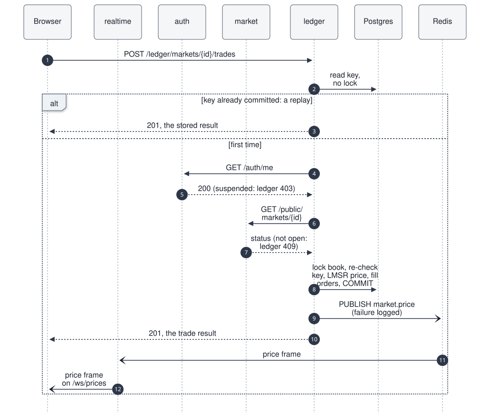

A replayed idempotency key is answered at once. Otherwise the ledger checks
the trader and the market against its local copy, in memory, with no call to
auth or market unless the market is missing from the copy; a copy older than
five seconds refuses with 503. It then
locks the `market_books` row, reads everything the trade decides from in one
statement after the lock, and prices the trade. A price beyond the request's
`max_cost` or `min_proceeds` is `409 price_beyond_limit`, with nothing
written; otherwise it writes and commits, and publishes the new price through
the bus, Redis locally and Valkey in production, to subscribed browsers. The
detailed version is [above](#a-trade-end-to-end).
**Drawn from:** ADR 0009, 0010, 0015, 0017 and 0022 (as amended by 0030),
0024, 0029, 0030, D-049; `backend/ledger_service/service/trading.py`,
`service/local_copy.py`, `core/pricing.py`.
[Source](diagrams/06-trade-sequence.mmd)

### 7. Delivery timeline

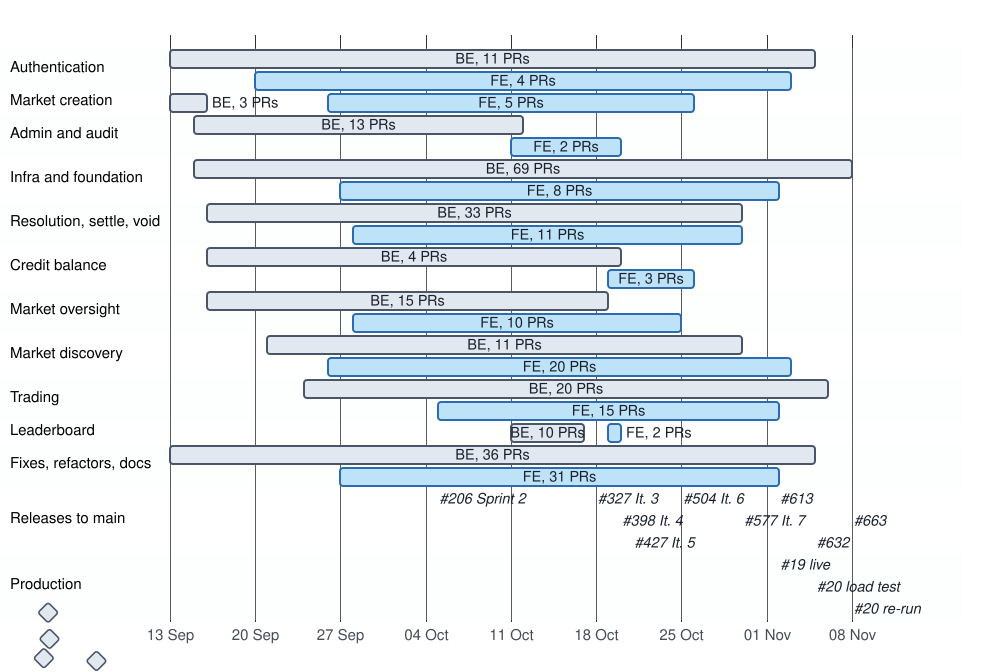

336 pull requests merged into `dev` or a stack branch, 13 September to 7 November
2026, the chart's cut-off: one bar per epic from its first to its last merged PR
(backend plain, frontend shaded), and the releases to `main`, the last on
7 November. Production went live on 1 November with #19, and the trade
endpoint was load-tested there (#20) on 4 November and again on 7 November,
after the release that brought price limits, the ledger's local copy and the
connection pools ([load-test.md](load-test.md)).
**Drawn from:** `gh pr list --state merged` and each PR's issue's `epic:`
label, and [load-test.md](load-test.md)'s results. [Source](diagrams/07-gantt.mmd)

### 8. Market lifecycle


The creator drafts, submits and publishes; the clock or an administrator
closes trading; a second administrator approves or rejects the creator's
proposed outcome; and the ledger settles or voids the market after moving the
money. Trading stops at `close_time` whatever the status column says. In
print it needs a landscape page: its text is about 5.3 pt at the portrait text
width and 8.2 pt across a landscape page's 24.6 cm.
**Drawn from:** `MarketStatus` in `backend/market_service/model/entities.py`,
`service/market_service.py`; ADR 0008, 0011, 0013, 0014, 0016, 0023, 0025.
[Source](diagrams/08-market-lifecycle.mmd)

### 9. Settlement

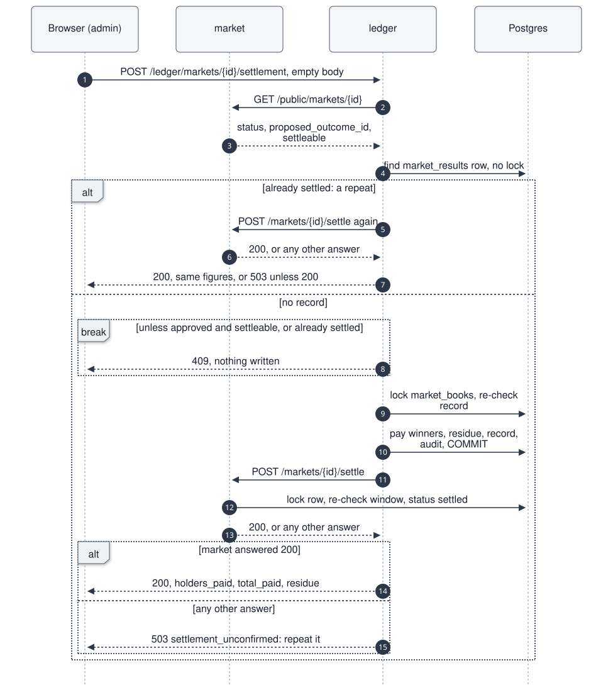

The ledger confirms the market is approved and past its dispute window, pays
the winning holders and records the result in one transaction under the book lock,
then asks market to mark it settled, answering 503 for the administrator to
repeat if that confirmation fails; a repeat is answered from the stored
record.
**Drawn from:** ADR 0019, 0023; `backend/ledger_service/service/settlement.py`.
[Source](diagrams/09-settlement-sequence.mmd)

### 10. Horizontal scaling, in production


The two app servers run the same services, so a server can be added or replaced;
Postgres and Valkey stay at one each. Pool and overflow per service add up to 19
clients a server, and every server connects through four PgBouncer pools that
hold 38 of Postgres's 47 or so connections however many servers run, so a third
server adds clients waiting on the same 38, and the ledger's pool of 24 holds
every ledger client on up to three (#667); the migrate steps connect directly,
one after another, in the room left. The close sweeper runs
on both servers, safely under SKIP LOCKED, and the leaderboard refresher on the
first only. Each server's ledger refreshes its local copy from the auth and
market on that same server, and calls that market for a settlement or a void. The
same idea was first run locally, two replicas behind one nginx, in
[horizontal-scaling.md](horizontal-scaling.md).
**Drawn from:** ADR 0011, 0020, 0021, 0026, 0030; `deploy/production/`,
`infra/terraform/{variables,databases}.tf`, [deployment.md](deployment.md)
"Connection budget", DECISIONS.md "Each service's connection pool is a
setting, sized to the database's ceiling".
[Source](diagrams/10-horizontal-scaling.mmd)

### 11. Live-price fan-out


The ledger publishes once to the bus after each commit, Redis locally and Valkey
in production, every realtime replica
receives every frame and forwards it to its own subscribed sockets, and a
browser reconciles against the ledger's snapshot on mount and on every
subscription acknowledgement.
**Drawn from:** ADR 0010, D-049; `backend/realtime_service/`,
`docs/api/realtime-service.md`. [Source](diagrams/11-realtime-fanout.mmd)

### 12. The `auth` and `audit` schemas

Refresh tokens are stored only as SHA-256 hashes and rotated on every use;
the append-only audit log records who acted on what, with no foreign keys,
and only `audit_svc` may read it.
**Drawn from:** `backend/auth_service/model/entities.py`,
`sql/02-schemas.sql`, ADR 0001, 0002, 0006.
[Source](diagrams/12-erd-auth-audit.mmd)

### 13. Simplified ERD

The core money and market tables. Solid lines are foreign keys; dotted "no FK"
lines are ids that cross a schema, because no service holds a grant on
another's. Balances are not stored: a balance is `SUM(amount)` over an
account's entries. Resting limit orders (`ledger.orders`) and the settlement
latch (`ledger.market_results`) are left out to keep the type legible; figure
4 has both.
**Drawn from:** ADR 0003, 0005, 0009; `backend/*/model/entities.py`,
`backend/ledger_service/service/posting.py`, `sql/02-schemas.sql`.
[Source](diagrams/13-erd-simplified.mmd)

### 14. Four user journeys


A trader's first trade, a market drafted and published, two administrators
resolving one, and a limit order filling inside another trader's trade. Each
box is coloured by the service that handles the step; "…" is that service's
market prefix, and the 24 h window is the default setting. A trade is decided
by its price limit (ADR 0029); the trade panel still sends the quote's
`state_version` instead until [FE] #644 lands, and the ledger still accepts it.
**Drawn from:** ADR 0008, 0009, 0010, 0011, 0013, 0014, 0016, 0019, 0023, 0024,
0029; `backend/*/controller/routes.py`, `backend/*/service/`,
`frontend/src/hooks/`, `frontend/src/components/markets/TradingPanel.tsx`.
[Source](diagrams/14-user-journeys.mmd)

### 15. LMSR price and cost

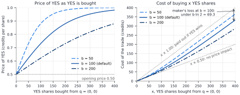

How the liquidity `b` sets price impact and the maker's bounded loss, drawn by
calling the ledger's own `core/lmsr.py`; `b` = 100 is the default.
**Drawn from:** `backend/ledger_service/core/lmsr.py`,
`backend/market_service/core/config.py`.
[Source](diagrams/15-lmsr.py)

### Tables for the proposal

[`proposal/api-endpoints-body.md`](proposal/api-endpoints-body.md) and
[`proposal/api-endpoints-appendix.md`](proposal/api-endpoints-appendix.md) are
generated by [`proposal/api_table.py`](proposal/api_table.py) from each
service's `app.openapi()`; [`proposal/api-endpoints.md`](proposal/api-endpoints.md)
is the full version, with a cross-check against `docs/api/` that is a note
for maintainers, not a list of responses.
[`proposal/risks.md`](proposal/risks.md) and
[`proposal/caching.md`](proposal/caching.md) are drafts for the team to edit.
