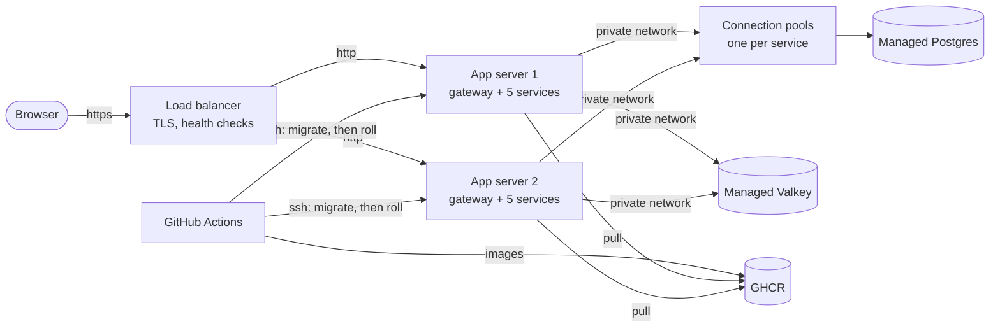

# Deploying to production

[5.3] #19. Every push to `main` deploys to DigitalOcean. This page covers how
it is put together, setting it up for the first time, and what to do when
something goes wrong. [ADR 0026](adr/0026-production-on-digitalocean.md) is
why it looks like this.



| Name | What answers |
| --- | --- |
| `https://<domain>` | the frontend |
| `https://auth.<domain>`, `market.`, `ledger.`, `audit.` | that service, with its `/docs` |
| `wss://realtime.<domain>/ws/prices` | live prices |

## What is where

| Path | What it is |
| --- | --- |
| `infra/terraform/` | everything on DigitalOcean: servers, load balancer, certificate, Postgres, Valkey, DNS, firewalls, and every generated secret |
| `infra/tf` | runs Terraform from its Docker image, so nobody installs it |
| `infra/push-secrets.sh` | copies Terraform's outputs into the GitHub `production` environment |
| `deploy/production/compose.yml` | what each app server runs |
| `deploy/production/gateway/` | the image that serves the frontend and routes each subdomain |
| `deploy/production/release.sh` | one deploy, run from GitHub: send files, migrate once, roll each server |
| `deploy/production/migrate.sh`, `ensure-database.sh` | on a server: roles and grants, then the three migrate steps |
| `deploy/production/roll.sh` | on a server: drain, start the new release, go back if it is unhealthy |
| `/opt/cs464/releases/<commit>/` | on a server: one release's own compose.yml, scripts and `release.env`; the live one and the one before are kept |
| `/opt/cs464/current` | on a server: a link to the live release's directory |
| `/opt/cs464/app.env` | on a server: the secrets and that server's settings, shared by every release and rewritten by every deploy |
| `deploy/production/test/` | the two tests below, run by `ci-deploy.yml` |
| `deploy/grafana/` | the dashboard and the five alert rules, imported into Grafana Cloud by hand |
| `.github/workflows/deploy.yml` | push to `main`: build and push the images, then run `release.sh` |

## Setting it up for the first time

You need: a DigitalOcean account, a domain, Docker, and `gh` logged in as an
admin of this repository.

1. **Credit.** The GitHub Student Developer Pack includes DigitalOcean
   credit. Claim it before anything else, so the first bill comes out of it.
2. **A domain.** Buy one (about US$10 a year), or claim a free one from the
   Student Pack.
3. **An API token.** In the DigitalOcean console go to API, then Generate New
   Token, with read and write access. Keep it in your shell only:

   ```bash
   export DIGITALOCEAN_TOKEN=<token>
   export TF_VAR_domain=<your domain>
   ```

4. **Hand the domain's DNS to DigitalOcean.** Create the domain alone first,
   then set the nameservers at your registrar to `ns1.digitalocean.com`,
   `ns2.digitalocean.com` and `ns3.digitalocean.com`:

   ```bash
   infra/tf init
   infra/tf apply -target=digitalocean_domain.cs464
   ```

   The certificate in the next step can only be issued once those
   nameservers are live. Check with `dig NS <domain>`. It usually takes
   minutes, and can take hours.
5. **Everything else.** Read the plan before you type `yes`. It is roughly 25
   resources and takes about ten minutes, most of it the databases:

   ```bash
   infra/tf apply
   ```

   `infra/terraform/terraform.tfstate` now holds every production secret. It
   is gitignored. Keep it, and do not share it.

   On a database that has never been deployed to, the four connection pools
   may fail here: each logs in as its service's role, and the first deploy's
   `ensure-database.sh` is what creates those roles. This has not been tried,
   and if it happens there is no tested way through yet. See "Connection
   budget" below, "A new environment".
6. **Give GitHub the secrets:**

   ```bash
   infra/push-secrets.sh
   ```

7. **Deploy.** Run the Deploy workflow by hand (Actions, Deploy, Run
   workflow, on `main`), or promote `dev` to `main`. The first run takes about
   ten minutes. When it is green, open `https://<domain>`.
8. **Seed the demo markets, if this site is for the showcase** (#609). Do it
   before anyone makes an administrator: the seed makes the site's first one,
   `admin_rachel`, the way ADR 0007 says a first administrator is made, and
   refuses a site that already has one. From `frontend/`, on this machine:

   ```bash
   npm run seed:production
   ```

   It asks you to type the domain. It refuses a site that already has a
   market, or any of its accounts, because a seed cannot be undone: ledger
   entries are never deleted. It makes the same two admins, nine traders and
   fourteen markets as the local seed (README, "A demo database") in about
   three minutes.

   Every account gets a generated password, in
   `~/cs464-production-accounts.txt`, readable by you only. It is the only
   copy, so move the passwords into a password manager and delete the file
   once they are safe. The repository's test password is never used here,
   because anyone can read it.

   Seed **one to two weeks before the showcase,** if you can. The browse
   page's "Biggest movers" band and each card's weekly change measure from
   trades at least seven days old, and a trade's time cannot be backdated.
   Seeded the day before, everything else is there and those two are not.

   The seed registers eleven accounts from one address in a few seconds.
   That fits inside #600's limits, 20 registrations an hour and 30 logins a
   minute from one address (ADR 0027).
9. **Your own administrator account.** Register on the site.
   - If you seeded, log in as `admin_rachel` and promote yourself from Admin →
     Users. That is how every administrator after the first is made, and the
     audit log records who did it.
   - If you did not seed, you are the first administrator. Run the promotion
     by hand from the first server, which can reach the database:

     ```bash
     ssh deploy@<first app server> # its address: infra/tf output app_hosts
     docker run --rm -it postgres:17.2-alpine psql "<infra/tf output -raw database_admin_url>" \
       -c "UPDATE auth.users SET role = 'admin' WHERE lower(username) = '<you>'"
     ```

   Log out and back in: the role rides in the token.

**If the seed stops partway.** Read what it printed last.
- **It stopped before "Published 14 markets":** nothing permanent was made
  except some accounts. A second run refuses, because those names exist. To
  start again, recreate the `cs464` database in the DigitalOcean console (or
  `infra/tf apply -replace=digitalocean_database_db.cs464`), then re-run the
  Deploy workflow, which rebuilds the schemas, and seed again.
- **It stopped after:** the markets, trades and ledger entries are
  permanent. Either leave the site half-seeded, or recreate the database as
  above, which also deletes anything else on the site.

Either way, keep the passwords file the first run wrote. It holds the only
copy of the passwords for the accounts that run made.

## A normal deploy

Merge to `main`. `deploy.yml` then:

1. Builds the five service images and the gateway, and pushes them to GHCR,
   tagged with the commit.
2. Sends every server its files and `app.env`, and logs it in to GHCR for
   this run only.
3. Ensures the database roles and grants, then migrates, once, from the
   first server.
4. Rolls the servers one at a time. Each one is drained, so the load
   balancer stops sending it traffic. Then its new release is started and
   must pass every health check, and it is undrained before the next server
   starts. The other servers carry the traffic meanwhile.
5. Checks every public name answers.

Two deploys never overlap. A push during a deploy waits for it to finish.
Only the newest waiting push is kept: GitHub cancels a waiting run when
another arrives. Nothing is lost, because the newest run deploys the newest
commit, which holds the others.

## When a deploy fails

The run goes red and says where. What state it left behind:

| Failed at | Servers are on |
| --- | --- |
| building the images | the old release; nothing was touched |
| migrating | the old release; no server was rolled |
| rolling a server | the old release, every one of them: the failed server went back by itself, and the ones before it were sent back |
| rolling a server, which "could not go back" | the failed server serves nothing and stays drained; the ones before it stay on the new release, serving. Fix forward, or `roll.sh` the failed one by hand once you know why |
| the public check | the new release, every one of them, all healthy behind the load balancer; look at DNS, the certificate and the load balancer |

"Every one of them" has three exceptions, and the run's log names the server
in each. A server on its first release has none to go back to, so it stays
on the new one. A server that cannot be asked which release it is on is
left as it is. And a server that fails to be sent back is only logged.
`deploy/production/release.sh`, step 3.

**A migration is not undone when its release is sent back.** So write every
migration to work with the release before it too: add a column, and drop the
old one a release later. A migration that breaks the old release breaks the
rollback. `CLAUDE.md` says the same, where backend changes are written.

**Going back on purpose.** If the release you are undoing added no
migration, revert it on `main`, which deploys again. If it did add one, that
does not work: the deploy migrates first, and Alembic refuses a database
already newer than the code it is given. Fix forward instead, keeping the
migration, or go back on each server by hand, which does not migrate. A
server keeps the release before, so: `ssh deploy@<server>`, then
`/opt/cs464/releases/<commit>/roll.sh`, one server at a time.
A release from before #640 (the connection pools) keeps asyncpg's statement
cache, which fails through a transaction-mode pool, so it needs the direct
addresses however you go back to it. Before a revert on `main`, copy each
role's direct address over its pooled one in GitHub, with the one-line
command in "Connection budget", "If a service cannot log in through its
pool". Before `roll.sh` by hand, do the same in `/opt/cs464/app.env` on
each server: give each `<SVC>_DATABASE_URL` the value of the
`<SVC>_DIRECT_DATABASE_URL` line in the same file.
Its images may have been removed, and the server is logged out of GHCR after
every deploy. So either make the `cs464-*` packages public once (each
package's settings on GitHub; the repository already is), or log in first:
`docker login ghcr.io -u <you>` with a token that can read packages.

**Changing a secret or a setting in `app.env`:** apply it, run
`infra/push-secrets.sh`, and deploy. Every release on a server reads the one
`app.env`, so the release before picks up the change too. Never rename or
remove a setting's name there, only add: the release before still reads the
old name, and going back to it would start it without one.

**Running compose on a server by hand:** every command on this page names
the shared `app.env` by its absolute path, because `current` is a symlink and
`../../app.env` from inside it is `/opt/app.env`. Each also sets `DRAIN_DIR`,
which `roll.sh` sets for itself: compose reads the whole file for any command,
and refuses to run without it.

**Logs:** `ssh deploy@<server>`, `cd /opt/cs464/current`, then
`DRAIN_DIR=/opt/cs464/drain docker compose --env-file /opt/cs464/app.env --env-file release.env logs -f ledger`.
The logs rotate at 50 MB per container. The services log JSON, one object per
line. To follow one request, grep or filter by `request_id`: a response's
`X-Request-ID` header is the value to search for, in the service logs and in
the gateway's `rid=`. The gateway stamps an ID when the client sent none, or
one the services would not keep, so a 502 or 504 the gateway answered itself
still has a line to find. With Grafana on, the dashboard does the same
search of the services' lines across both servers at once, though not of the
gateway's: see "Following one request" below.

**The client's address:** the gateway resolves it and overwrites
`X-Forwarded-For` with that one address (`set_real_ip_from` in
`deploy/production/gateway/default.conf.template`). uvicorn trusts the
leftmost entry of that header, which a visitor can write, so passing it on
would let anyone pick the address a service sees. Only the load balancer,
which connects from inside the VPC (`10.64.0.0/20`), is trusted to have set
it. #600.

**One-off check after the release that carries this reaches production,
before the release that adds the per-IP login limits:** from a machine whose
public address you know (`curl -s https://ifconfig.me`), send one identifiable
request: `curl -s -H 'X-Request-ID: probe-600' https://auth.<domain>/health`.
Then, on an app server in `/opt/cs464/current`, find that request's line by
its ID (the gateway logs the path, never the query string):
`DRAIN_DIR=/opt/cs464/drain docker compose --env-file /opt/cs464/app.env --env-file release.env logs --tail 200 gateway | grep 'rid=probe-600'`.
Its first field, the client address, must be exactly your public address. Ignore
the `/lb-health` lines: the load balancer sends those itself every few
seconds, so they are expected to show an address inside `10.64.0.0/20`. If
your line shows anything else, a `10.64.x` address or a public address you do
not recognise, stop: the per-IP limits must not ship until `set_real_ip_from`
is fixed, or every visitor shares one rate-limit bucket.

## Health and readiness

Every service answers two paths. `/health` says the process is up, and checks
nothing else. The load balancer (through the gateway's `/lb-health`, which
asks the ledger), Docker, `roll.sh` and `release.sh` use it. `/ready` says the
service can reach its database (realtime: Redis), and answers 503 naming the
one that failed. The dashboard and the alerts use it.

The load balancer does not use `/ready` on purpose. The database is one
managed instance shared by every server, so taking a server out of rotation
cannot fix it. It would only turn "trades fail with an error" into the load
balancer's bare 503 for the whole site, homepage included, and make a deploy
during a blip roll back. So a server whose auth or market service is broken
keeps its traffic, and the `cs464-service-down` alert ("a service is down or
not ready, per service per server") is what tells you. It reads the same
checks through each service's `service_dependency_ready` metric. With Grafana
off, nothing watches `/ready` and you have to look. ADR 0028 has the
reasoning.

The gateway returns 404 for `/ready` on every service's subdomain. It names
the failing dependency, and only the monitoring on the private network needs
it. To look yourself:
`DRAIN_DIR=/opt/cs464/drain docker compose --env-file /opt/cs464/app.env --env-file release.env exec gateway wget -qO- http://ledger:8000/ready`.
Ready prints `{"status":"ready",...}`. Not ready prints no body: busybox
`wget` shows only `wget: server returned error: HTTP/1.1 503 ...`, and that
line is the answer.

Every service also exposes `/metrics`, the counters and gauges Grafana Alloy
scrapes. It is private the same way: the gateway returns 404 for it on every
subdomain, and only Alloy, on the private network, reads it. To look
yourself, use the `exec gateway wget` command above with `/metrics` in place
of `/ready`.

Every path under `/internal/` is private too: the gateway returns 404 for it
on every subdomain, with `LEDGER_SERVICE_KEY` or without it. Those are the
routes the ledger reads from auth and market over the private network (ADR
0021, ADR 0030). All three hidden paths are listed in
`deploy/production/gateway/private-paths.inc`; add a path there to hide it.

## Monitoring: first-time setup

Each server runs Grafana Alloy, which sends metrics, logs and traces to
Grafana Cloud. It needs six values and one token from your Grafana Cloud
stack. Alloy is optional: with no token, no Alloy runs and the deploy works
as before.

1. Make a free Grafana Cloud stack: grafana.com, *My Account*, *Add stack*.
2. *Prometheus* tile, *Details*. Copy the **remote write endpoint**
   (`https://prometheus-<...>.grafana.net/api/prom/push`) and the numeric
   **username / instance ID**.
3. *Loki* tile, *Details*. Copy the **URL** and add `/loki/api/v1/push` to
   the end of it. Copy the **user** too.
4. *OpenTelemetry* tile (*Connections*, *OpenTelemetry (OTLP)*). Copy the
   **OTLP endpoint** (`https://otlp-gateway-<...>.grafana.net/otlp`) and the
   **instance ID**. Use it exactly as shown, ending in `/otlp`. Alloy adds
   `/v1/traces` itself, so a longer value would send traces to the wrong
   address.
5. *Access policies*: make a policy named `cs464-servers` with the scopes
   `metrics:write`, `logs:write` and `traces:write`, and nothing else. It
   needs no read scope.
   Then make a token for that policy and copy it. Grafana shows it once.
6. Put them in the GitHub `production` environment. Only a run on `main` can
   use it (ADR 0026). The six values are web addresses and numbers, not
   secrets, so they are variables:

   ```bash
   gh variable set GRAFANA_PROMETHEUS_URL  --env production --body '<remote write URL>'
   gh variable set GRAFANA_PROMETHEUS_USER --env production --body '<instance id>'
   gh variable set GRAFANA_LOKI_URL        --env production --body '<loki push URL>'
   gh variable set GRAFANA_LOKI_USER       --env production --body '<loki user>'
   gh variable set GRAFANA_OTLP_URL        --env production --body '<otlp endpoint>'
   gh variable set GRAFANA_OTLP_USER       --env production --body '<instance id>'
   gh secret   set GRAFANA_CLOUD_TOKEN     --env production
   ```

   The last one is the only secret. `gh` asks for it on stdin: paste the
   token there, so it never appears on a command line.

If your stack's pages name these differently, follow what they show and fix
this list.

**The next deploy from `main` picks them up.** `release.sh` rewrites each
server's `app.env` on every deploy, so nothing on a server needs editing by
hand. Alloy starts after the roll, once the new release is serving.

**Mistakes fail early.** If the token is set, `release.sh` needs all six
values, and each URL must start with `https://`. It checks this before it
touches any server, so a missing or malformed value stops the deploy and
changes nothing. It does not check the endings: the Loki URL must end in
`/loki/api/v1/push` and the Prometheus one in `/api/prom/push`, or Grafana
receives nothing.

**Alloy cannot break a deploy.** It is started last, as best effort. If it
will not start or keeps restarting, the roll prints a warning and carries on.
The server then stops sending metrics, and if it was sending in the last
hour, `cs464-service-down` emails about it within about 8 minutes. A server
that has never sent, or has been silent for over an hour, pages nobody: the
checklist's `server` step is what catches that. A wrong token or a wrong URL ending looks the same
from Grafana: Alloy runs and the deploy is green, but no data arrives, so the
same alert fires. After an hour that alert clears by itself, even if the
server is still silent, so a "resolved" email is not proof that data is back:
check the dashboard. Alloy's log on a server says why: in
`/opt/cs464/current`, run
`DRAIN_DIR=/opt/cs464/drain docker compose --profile observability --env-file /opt/cs464/app.env --env-file release.env logs --tail 100 alloy`.

**To switch Alloy off,** delete the token and deploy:

```bash
gh secret delete GRAFANA_CLOUD_TOKEN --env production
```

With no token, the next deploy removes the Alloy container from each server.
The variables can stay. They do nothing without the token.

Until a deploy succeeds, Alloy keeps the old token and keeps shipping. To stop
it at once, also revoke the token in Grafana Cloud: *Access policies*, the
`cs464-servers` policy, its token, *Delete*.

`infra/push-secrets.sh` does not set any of these. They are not Terraform's.

## Monitoring: dashboard and alerts

`deploy/grafana/` holds the dashboard and the five alert rules. Import them
once into your Grafana Cloud stack (`https://<stack>.grafana.net`). The
README's "Monitoring" section says what they show and when each alert fires.

**The dashboard.** *Dashboards*, *New*, *Import*, then upload
`deploy/grafana/dashboard.json` into a folder named `CS464`. It is then
*CS464 / Overview*. It names no datasource of its own: the `prometheus` and
`loki` boxes at its top pick them, so it imports into any stack unchanged.

**The alerts.** `deploy/grafana/alerts.yaml` is in Grafana's alert-rule
provisioning format. It puts the rules in a `CS464` folder and sends each to
an email contact point named `cs464-email`. A new Grafana Cloud stack has no
email contact point at all, so make that one first: *Alerting*, *Contact
points*, *Add*, type *Email*, with the addresses to page. Its queries
name the datasource `grafanacloud-prom`, a Grafana Cloud stack's own
Prometheus. Check yours under *Connections*, *Data sources*: the UID is the
last part of the Prometheus one's URL. If it differs, change every
`datasourceUid: grafanacloud-prom` in alerts.yaml before importing.

`cs464-service-down` also fires for a server that has stopped sending
metrics: one seen in the last hour and silent now. If that server stays
silent, the alert clears by itself about an hour after it went quiet.
Removing a server on purpose, by lowering `app_server_count`, pages once.

**How they were imported (2026-11-04).** Through the API, with a
service-account token that had the Admin role and expired after a day. The
account was deleted afterwards. The file is YAML for file provisioning, so it
went in as JSON: the group's rules, each given `folderUID: cs464`,
`ruleGroup: cs464` and `orgID: 1`, wrapped as
`{"title": "cs464", "folderUid": "cs464", "interval": 60, "rules": [...]}`,
sent with `PUT /api/v1/provisioning/folder/cs464/rule-groups/cs464`. The
request carried the header `X-Disable-Provenance: true`, so the rules can
still be edited in the UI. The contact point went in the same way. Grafana's
export of the group matched this file, apart from defaults it fills in
itself, so the file in the repo is the commented original.

**On a new stack, import `cs464-service-down` paused,** or resume it only once
every server is sending. Until a server sends metrics the rule has no data,
and no data counts as down, so it would email every few minutes. Ours was
resumed after #632 reached production.

**Linking a log line to its trace.** Grafana Cloud's own Loki datasource is
read-only, so it cannot take a derived field. A *correlation* does the same
job: *Administration*, *Plugins and data*, *Correlations*. Ours is named
*Open trace*. It goes from the Loki datasource to the Tempo one, and is of
type *Query*, on the field `Line`. It has a regex transformation,
`"trace_id": "(\w+)"`, into the variable `trace_id`, and the target query is
`${trace_id}`. A log line's details then show a button that opens its trace.
The regex matches the services' JSON lines exactly: `json.dumps` writes a
space after the colon.

**Following one request.** Copy the `X-Request-ID` header from a response
(the browser's developer tools, *Network*). Paste it into the dashboard's
`request_id` box. The *Logs* panel then shows only that request's lines, from
every service it touched, and a line's `trace_id` opens the trace. The
gateway's own lines are not JSON, so they carry no `service` label and the
panel leaves them out. To find one, use *Explore* on Loki with
`{container="gateway"} |= "rid=<request id>"`.

**What a trace keeps.** Spans carry no query string, cookie or Authorization
header. They do keep the client address and the user agent, by decision, for
chasing abuse. The gateway's access lines start with the client address too.
The services' own JSON log lines carry no IP, except realtime's websocket
handshake lines, which uvicorn writes as
`<client ip>:<port> - "WebSocket <path>" [accepted]` (or `403`), with the path
as requested, query string included. The socket never takes a token in its
query string, by design (docs/api/realtime-service.md), so nothing secret is in that line.

**Things that look wrong and are not:**

- A trace makes two hops, and the two addresses end differently. Service to
  the local Alloy: `release.sh` sets `TRACING_ENDPOINT` to
  `http://alloy:4318/v1/traces`, which must be the full path, ending in
  `/v1/traces`. Alloy to Grafana Cloud: `GRAFANA_OTLP_URL` is the base
  address ending in `/otlp`, and Alloy adds `/v1/traces` itself (first-time
  setup, step 4). A wrong `TRACING_ENDPOINT` breaks nothing else: the
  service's log just shows OpenTelemetry warnings that it is dropping spans.
  `release.sh` also sets `TRACING_SAMPLE_RATIO=0.1`, so production keeps one
  trace in ten, because a 1-vCPU server spent 12–16% of its CPU on tracing at
  100% (#20, 2026-11-04); local and CI keep 1.0.
- The same "dropping span" warnings appear while Alloy is down, including
  the moments between a roll and Alloy starting. They are harmless.
- Background work makes small traces with no request behind them: the close
  sweep, every 10 s on each server, and the leaderboard refresh, every 60 s
  on the first server. In Tempo, `{ kind = server }` shows requests only.
- A websocket's span is named `HTTP`. Find one with
  `{ .http.target = "/ws/prices" }`.
- The *Book-lock wait* panel covers every caller of `lock_book`, not just
  trades: limit orders, cancels, settlements and voids wait on the same
  lock.

**The series budget.** The free tier allows 10,000 active series. About 45
method-route pairs × 12 histogram series ≈ 540, plus about 135
request-counter series, about 200 process/Python series, and about 40
business series. That is ≈ 950 per server, ≈ 1,900 for two, well under 10k.
Re-measure it on the *Usage* page around 2026-11-11, a week after monitoring
went live, and update this paragraph.

**Post-release checklist.** Run it once, after the first deploy from `main`
that carries this work. It was run after #632, on 2026-11-04. What it found
is under the list.

1. Unpause `cs464-service-down`, which a new stack imports paused:
   *Alerting*, *Alert rules*, *CS464*, the rule, *Resume evaluation*. Do it once every server has been sending for
   a few minutes, or it pages at once.
2. Every panel on *CS464 / Overview* has data. Make a trade first, or the
   trading panels have nothing to show.
3. The dashboard's `server` box lists every server, `app-1` up to the last
   `app-N`. A server missing there has never sent, and no alert covers it.
4. **Ask Ernest before you SSH.** On one server, run
   `docker stats --no-stream` and put Alloy's memory use in the README's
   cost paragraph, in place of "a little memory". If it is over about
   300 MB, consider a `mem_limit` on `alloy` in
   `deploy/production/compose.yml`.
5. Tempo shows a trade's spans in the ledger. A trade on a market that has
   already been traded calls no other service (ADR 0030), so to see one
   trace across services, use a market's first trade, which fetches its
   terms from market, or a settlement. No span carries a query string,
   cookie or Authorization header (the client address and user agent are
   kept, by decision).
6. Trigger `cs464-service-down` once. **Ask Ernest before you SSH.** On one
   server, in `/opt/cs464/current`, run
   `DRAIN_DIR=/opt/cs464/drain docker compose --env-file /opt/cs464/app.env --env-file release.env stop audit`.
   Wait 6 minutes, and check that the email arrives. It can take a minute
   more. Then run the same command with `start audit` and check that the
   alert clears.

What the first run found (2026-11-04, after #632):
- Steps 1, 3, 4 and 6 passed. Both servers report every service and
  dependency.
- Alloy used 169 MB on `app-1` and 51 MB on `app-2`, so it needs no
  `mem_limit`.
- `audit` stopped on `app-1` at 20:08 SGT. The firing email arrived inside
  six minutes. After the restart at 20:17, the resolved email came within
  about five, the notification policy's batching interval.
- The dashboard first opened on the wrong Loki, and the server commands here
  failed as written. Both were fixed in #634.
- Steps 2 and 5 wait for the load test's trades (#20).

## Connection budget

The managed Postgres has one connection limit for everything that connects
to it: about 47 on the 2 GB plan (25 for each GB, less 3 DigitalOcean keeps
for itself). Every app server runs auth, market, ledger and audit, so if each
connected straight to Postgres, two servers would use 40 and a third would
not fit.

So the apps do not connect to Postgres. Each service role has its own
DigitalOcean connection pool (PgBouncer), in `infra/terraform/databases.tf`:

| Pool | Logs in as | Mode | Server connections |
| --- | --- | --- | --- |
| `cs464-auth` | `auth_svc` | transaction | 6 |
| `cs464-market` | `market_svc` | transaction | 6 |
| `cs464-ledger` | `ledger_svc` | transaction | 14 |
| `cs464-audit` | `audit_svc` | transaction | 2 |

The pools hold 28 connections to Postgres, however many servers run. The
other 19 or so stay free for what connects directly: the three migrate steps
(one at a time), `ensure-database.sh`, and an operator with `psql`. A request
that finds its pool busy waits its turn inside the pool, instead of failing
with "too many connections".

The services' own SQLAlchemy pools (`DATABASE_POOL_SIZE` and
`DATABASE_MAX_OVERFLOW` in `deploy/production/compose.yml`) now count
connections to the pooler, which are cheap: each pool takes up to 5,000. Per
server: auth 3+1, market 3+2, ledger 10+5, audit 1+1, so 26. Three servers
make 78, all sharing the same 28.

**Two addresses per role.** `app.env` carries both, and `release.sh` writes
them from the GitHub secrets that `infra/push-secrets.sh` sets:

- `<SVC>_DATABASE_URL`, which the apps use, is the pool:
  `postgresql+asyncpg://<svc>_svc:<PASSWORD>@<pool private host>:<pool port>/cs464-<svc>?ssl=require`.
  The part after the port names the pool, not the database. That is how
  DigitalOcean addresses a pool: its API documents one on `defaultdb` as
  `...:25061/backend-pool`. The pool knows which database it serves.
- `<SVC>_DIRECT_DATABASE_URL`, which the migrate steps use, is Postgres
  itself, the address every service used before the pools. A migration is
  one long transaction that takes table locks, and should not hold one of a
  pool's few server connections while it does. The migrate engine also
  keeps asyncpg's statement cache, which the apps turn off (below). The
  stack test checks that the migrate steps never reach the pooler. Audit has
  no migrate step.
  Its direct address is there for an operator, and so that every role has
  both.

**What transaction mode rules out.** A pooled connection belongs to a client
only for one transaction, so nothing may leave state on a connection for the
next transaction. Checked in `backend/` on 2026-11-07:

- The leaderboard refresh's advisory lock is `pg_advisory_xact_lock`, which
  ends with its transaction, and it is the only advisory lock.
- No service uses LISTEN or NOTIFY: live prices go over Redis (ADR 0010).
- No service makes a temporary table or runs a session-level `SET`. The
  one `SET LOCAL` is in a test.
- A named prepared statement lives on one server connection, and the next
  transaction may get another. So every service's `core/database.py` turns
  asyncpg's statement cache off (`connect_args={"statement_cache_size": 0}`),
  and asyncpg sends only unnamed statements. SQLAlchemy's own cache stays
  on. DECISIONS.md, "asyncpg's statement cache is off in every engine", has
  the measurements.
- `pool_pre_ping` stays on in every service's `core/database.py`, and
  nothing there rewrites the address.

**Which users a pool may log in as (checked 2026-11-07).** #640's design
asked first whether DigitalOcean would pool a role created by SQL, like
`ledger_svc`, or only a user made through its API. In the console, the
Create Connection Pool dialog's user list shows `audit_svc`, `auth_svc`,
`doadmin`, `ledger_svc` and `market_svc`, so SQL-created roles are accepted.
Its default is "Use inbound user", under the label "User privileges override
(Optional)". It also says each pool "shares its assigned backend processes
with up to 5000 client connections". What the dialog cannot show is whether
the pool logs in with the password `ensure-database.sh` sets. The first
apply and deploy are the test of that. If it cannot, the fallback in #640's
design is a PgBouncer container on each server instead.

**Turning the pools on (once, in two deploys).** Every release on a server
reads the one shared `app.env`, and `release.sh` rewrites it on every server
before it rolls any of them. So whatever address a deploy writes, the release
before is also run with it: when a roll fails and `roll.sh` restarts the old
release, and when a release is sent back. Code from before #640 keeps
asyncpg's statement cache, and through a transaction-mode pool it fails with
`prepared statement "__asyncpg_stmt_N__" does not exist`. `/health` stays
green while it does. So the apps move to the pools only once the release
before them is code that turns the cache off:

1. Before the release that brings the pools reaches `main`, run
   `infra/tf plan`. It should add the four
   `digitalocean_database_connection_pool.service[...]`, change the four
   `*_database_url` outputs and add four `*_direct_database_url` ones, and
   destroy nothing.
2. `infra/tf apply`. The pools now exist and nothing uses them yet.
3. Set only the four direct addresses in GitHub, and leave
   `<SVC>_DATABASE_URL` as it is, on the direct addresses:

   ```bash
   infra/tf output -raw auth_direct_database_url | gh secret set AUTH_DIRECT_DATABASE_URL --env production
   infra/tf output -raw market_direct_database_url | gh secret set MARKET_DIRECT_DATABASE_URL --env production
   infra/tf output -raw ledger_direct_database_url | gh secret set LEDGER_DIRECT_DATABASE_URL --env production
   infra/tf output -raw audit_direct_database_url | gh secret set AUDIT_DIRECT_DATABASE_URL --env production
   ```

   Do not run `infra/push-secrets.sh` yet: it would also move
   `<SVC>_DATABASE_URL` to the pools.
4. Merge to `main`, which deploys. The new code runs on the direct
   addresses, with the cache off. Deploying it before step 3 fails at once
   and touches nothing, because `release.sh` requires the direct addresses.
   Check each service's `/ready` (the `exec gateway wget` command in
   "Health and readiness").
5. `infra/push-secrets.sh`, then run the Deploy workflow again by hand.
   This deploy moves the apps to the pools. The release before it is now step
   4's, which turns the cache off, so a failed roll or a send-back is safe.
   `/health` checks nothing, so a green deploy does not prove the pools
   work. Check each service's `/ready` again, and make a trade.

Until step 5's deploy has succeeded, let no deploy of older code run with
the pooled addresses in GitHub. Its apps would keep the cache on through the
pools, and its migrate steps would go through the pools too.

**If a service cannot log in through its pool,** put the apps back on the
direct addresses. This needs no code change. For each role, copy the direct
address over the pooled one, then run the Deploy workflow again:

```bash
infra/tf output -raw ledger_direct_database_url | gh secret set LEDGER_DATABASE_URL --env production
```

The next `infra/push-secrets.sh` puts the pooled addresses back.

**A new environment: not solved yet.** The pools need the service roles,
and the roles are made by the first deploy. If `infra/tf apply` cannot create
the pools on a database that has never been deployed to, this page has no
tested way through. Without the pools there are no `*_database_url` outputs,
so `infra/push-secrets.sh` stops at its first `AUTH_DATABASE_URL`, and
nothing after it is set. The way through would be a first apply that leaves
the pools out, or every remaining secret set by hand. Nobody has tried
either. Production already has the roles, so this matters only for a
rebuild from nothing.

## Scaling

- **More app servers:** raise `app_server_count` in
  `infra/terraform/variables.tf`, `infra/tf apply`, `infra/push-secrets.sh`,
  then deploy. The load balancer picks the new server up by its tag.
- **Postgres's connections no longer limit the number of servers.** Every
  server shares the four connection pools, which hold 28 of the 2 GB plan's
  47 or so, however many servers run ("Connection budget" above). What a
  third server adds is clients waiting on the same 28. To give the database
  more work at once, raise a pool's `size` in `infra/terraform/databases.tf`.
  The pools together must leave room for the direct connections. Past about
  40 in all, take a bigger `database_size`.
- **Bigger servers:** change `app_server_size`, then resize one server at a
  time, or both go down together: `infra/tf apply
  -target='digitalocean_droplet.app[0]'`, wait for it to be healthy behind
  the load balancer, then the same for `app[1]`.

## What it costs

DigitalOcean's list prices when this was written. Check the console for
today's.

| Part | Plan | US$ a month |
| --- | --- | --- |
| 2 app servers | `s-1vcpu-2gb` | 24 |
| Load balancer | 1 node | 12 |
| Postgres | `db-s-1vcpu-2gb`, chosen for its connection limit | 30 |
| Valkey | `db-s-1vcpu-1gb` | 15 |
| Grafana Cloud | free tier | 0 |
| **Total** | | **about 81**, plus the domain |

Grafana Cloud's free tier allows 10,000 active series, 50 GB of logs and
50 GB of traces, kept for 14 days, and 3 users. We expect about 1,900 series
(the series budget above). Alloy itself used 51–169 MB of memory per server,
minutes after its first deploy. Images on GHCR are free for a public
repository. To stop paying, run `infra/tf destroy`. That deletes the database too, so take a backup first if
anything in it matters.

## Tests

`ci-deploy.yml` runs these on every pull request that touches the stack. Both
need only Docker.

- `deploy/production/test/stack-test.sh` runs `compose.yml`, the gateway and
  the scripts on one machine. It uses a local registry, and a Postgres whose
  admin is not a superuser, like DigitalOcean's. It checks routing, login and
  the cookie's domain, the websocket and its origin check, draining, and both
  ways a release can fail.
- `deploy/production/test/release-test.sh` runs `release.sh` against fake
  servers. It checks the order of work, that a failed migration rolls
  nothing, and that one failed server sends every other server back.

What only a real deploy proves: the DigitalOcean resources themselves, the
certificate, TLS to the managed databases, and DigitalOcean's own pools. The
stack test stands in for those pools with a PgBouncer in transaction mode,
at least as strict as DigitalOcean's: no prepared-statement tracking, and each
client's next transaction on another server connection. The apps reach
Postgres through it, the migrate steps reach Postgres directly, and the test
checks both.

## Not done yet

- **Staging** is dropped from scope (ADR 0026, amended 2026-11-08).
- **Re-measuring the series budget.** Around 2026-11-11, a week after
  monitoring went live with #632, read the real series count off Grafana
  Cloud's *Usage* page and update the estimate above and the README.
- **Load test numbers:** #20, against this deployment.
