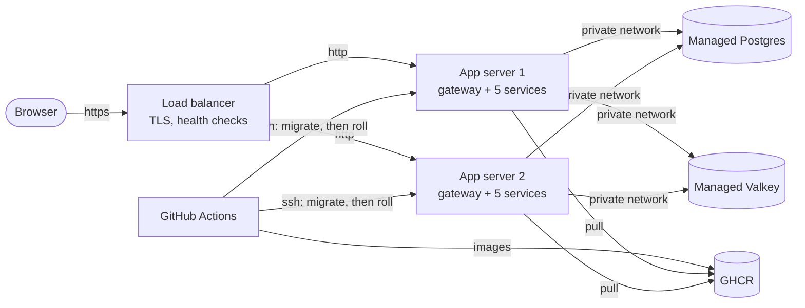

# Deploying to production

[5.3] #19. Every push to `main` deploys to DigitalOcean. This page covers how
it is put together, setting it up for the first time, and what to do when
something goes wrong. [ADR 0026](adr/0026-production-on-digitalocean.md) is
why it looks like this.



| Name | What answers |
| --- | --- |
| `https://<domain>` | the frontend |
| `https://auth.<domain>`, `market.`, `ledger.`, `audit.` | that service, with its `/docs` |
| `wss://realtime.<domain>/ws/prices` | live prices |

## What is where

| Path | What it is |
| --- | --- |
| `infra/terraform/` | everything on DigitalOcean: servers, load balancer, certificate, Postgres, Valkey, DNS, firewalls, and every generated secret |
| `infra/tf` | runs Terraform from its Docker image, so nobody installs it |
| `infra/push-secrets.sh` | copies Terraform's outputs into the GitHub `production` environment |
| `deploy/production/compose.yml` | what each app server runs |
| `deploy/production/gateway/` | the image that serves the frontend and routes each subdomain |
| `deploy/production/release.sh` | one deploy, run from GitHub: send files, migrate once, roll each server |
| `deploy/production/migrate.sh`, `ensure-database.sh` | on a server: roles and grants, then the three migrate steps |
| `deploy/production/roll.sh` | on a server: drain, start the new release, go back if it is unhealthy |
| `deploy/production/test/` | the two tests below, run by `ci-deploy.yml` |
| `.github/workflows/deploy.yml` | push to `main`: build and push the images, then run `release.sh` |

## Setting it up for the first time

You need: a DigitalOcean account, a domain, Docker, and `gh` logged in as an
admin of this repository.

1. **Credit.** The GitHub Student Developer Pack includes DigitalOcean
   credit. Claim it before anything else, so the first bill comes out of it.
2. **A domain.** Buy one (about US$10 a year), or claim a free one from the
   Student Pack.
3. **An API token.** In the DigitalOcean console go to API, then Generate New
   Token, with read and write access. Keep it in your shell only:

   ```bash
   export DIGITALOCEAN_TOKEN=<token>
   export TF_VAR_domain=<your domain>
   ```

4. **Hand the domain's DNS to DigitalOcean.** Create the domain alone first,
   then set the nameservers at your registrar to `ns1.digitalocean.com`,
   `ns2.digitalocean.com` and `ns3.digitalocean.com`:

   ```bash
   infra/tf init
   infra/tf apply -target=digitalocean_domain.cs464
   ```

   The certificate in the next step can only be issued once those
   nameservers are live. Check with `dig NS <domain>`. It usually takes
   minutes, and can take hours.
5. **Everything else.** Read the plan before you type `yes`. It is roughly 25
   resources and takes about ten minutes, most of it the databases:

   ```bash
   infra/tf apply
   ```

   `infra/terraform/terraform.tfstate` now holds every production secret. It
   is gitignored. Keep it, and do not share it.
6. **Give GitHub the secrets:**

   ```bash
   infra/push-secrets.sh
   ```

7. **Deploy.** Run the Deploy workflow by hand (Actions, Deploy, Run
   workflow, on `main`), or promote `dev` to `main`. The first run takes about
   ten minutes. When it is green, open `https://<domain>`.
8. **The first administrator,** as ADR 0007 says. Register on the site, then
   run the promotion from the first server, which can reach the database:

   ```bash
   ssh deploy@<first app server> # its address: infra/tf output app_hosts
   docker run --rm -it postgres:17-alpine psql "<infra/tf output -raw database_admin_url>" \
     -c "UPDATE auth.users SET role = 'admin' WHERE lower(username) = '<you>'"
   ```

   Log out and back in. Every later administrator is promoted from the site.

## A normal deploy

Merge to `main`. `deploy.yml` then:

1. Builds the five service images and the gateway, and pushes them to GHCR,
   tagged with the commit.
2. Sends every server its files and `app.env`, and logs it in to GHCR for
   this run only.
3. Ensures the database roles and grants, then migrates, once, from the
   first server.
4. Rolls the servers one at a time. Each one is drained, so the load
   balancer stops sending it traffic. Then its new release is started and
   must pass every health check, and it is undrained before the next server
   starts. The other servers carry the traffic meanwhile.
5. Checks every public name answers.

Two deploys never overlap. A push during a deploy waits for it to finish.

## When a deploy fails

The run goes red and says where. What state it left behind:

| Failed at | Servers are on |
| --- | --- |
| building the images | the old release; nothing was touched |
| migrating | the old release; no server was rolled |
| rolling a server | the old release, every one of them: the failed server went back by itself, and the ones before it were sent back |
| the public check | the new release, every one of them, all healthy behind the load balancer; look at DNS, the certificate and the load balancer |

**A migration is not undone when its release is sent back.** So write every
migration to work with the release before it too: add a column, and drop the
old one a release later. A migration that breaks the old release breaks the
rollback.

**Going back on purpose** to an earlier release that was deployed before:
re-run the Deploy workflow for that commit, or revert on `main`, which deploys
again. To move one server by hand: `ssh deploy@<server>`, `cd /opt/cs464`,
`./roll.sh <commit sha>`.

**Logs:** `ssh deploy@<server>`, `cd /opt/cs464`, then
`docker compose --env-file app.env --env-file release.env logs -f ledger`.
The logs rotate at 50 MB per container. #599 adds a dashboard.

## Scaling

- **More app servers:** raise `app_server_count` in
  `infra/terraform/variables.tf`, `infra/tf apply`, `infra/push-secrets.sh`,
  then deploy. The load balancer picks the new server up by its tag.
- **The limit is Postgres's connections.** Two servers use 40 of the 2 GB
  plan's 47 or so, plus three for the migrate steps. A third server needs the
  pool sizes in `deploy/production/compose.yml` lowered, or a bigger
  `database_size`. DECISIONS.md, "Each service's connection pool is a
  setting, sized to the database's ceiling".
- **Bigger servers:** change `app_server_size`. That rebuilds the servers, one
  apply at a time. Deploy afterwards so the new ones get the app.

## What it costs

DigitalOcean's list prices when this was written. Check the console for
today's.

| Part | Plan | US$ a month |
| --- | --- | --- |
| 2 app servers | `s-1vcpu-2gb` | 24 |
| Load balancer | 1 node | 12 |
| Postgres | `db-s-1vcpu-2gb`, chosen for its connection limit | 30 |
| Valkey | `db-s-1vcpu-1gb` | 15 |
| **Total** | | **about 81**, plus the domain |

Images on GHCR are free for a public repository. To stop paying, run
`infra/tf destroy`. That deletes the database too, so take a backup first if
anything in it matters.

## Tests

`ci-deploy.yml` runs these on every pull request that touches the stack. Both
need only Docker.

- `deploy/production/test/stack-test.sh` runs `compose.yml`, the gateway and
  the scripts on one machine. It uses a local registry, and a Postgres whose
  admin is not a superuser, like DigitalOcean's. It checks routing, login and
  the cookie's domain, the websocket and its origin check, draining, and both
  ways a release can fail.
- `deploy/production/test/release-test.sh` runs `release.sh` against fake
  servers. It checks the order of work, that a failed migration rolls
  nothing, and that one failed server sends every other server back.

What only a real deploy proves: the DigitalOcean resources themselves, the
certificate, and TLS to the managed databases.

## Not done yet

- **Staging.** #19 also asks for a staging environment on its own database.
  `infra/terraform` would run it as a second workspace. It is not built.
- **Monitoring and alerts:** #599. Until then, DigitalOcean's server and
  database graphs are the only view.
- **Login rate limiting:** #600.
- **Load test numbers:** #20, against this deployment.
